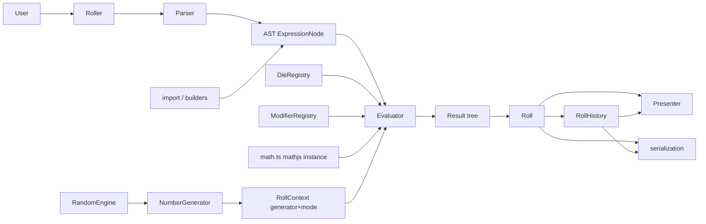

# Requirements

### Overview & Goals
Redesign `rpg-dice-roller` as a **clean-break major version in TypeScript**. The new structure should be easier to understand, maintain and extend. The deliverable is the **API/class design plus a TypeScript skeleton** (interfaces, types, class/function stubs). Roll logic (evaluation, modifier behaviour, presenter output) is left for you to implement. The existing JS in `src/` is used only as a reference for *functionality*, not for structure.

All work happens on the branch `next/re-structure`, created from the local `next/develop`. Remote `next/develop` (earlier TypeScript work) is ignored.

### Scope
**In scope**
- New naming and class structure, with no confusingly similar names.
- A notation pipeline: `Parser` → typed plain-data **AST** → `Evaluator` → typed plain-data **result tree** → `Presenter`.
- Modular dice. A die can be a plain object, a class instance, or an object with methods. `min`/`max`/`average`/`faceCount` can be numbers or functions that return a number, and an optional `roll()` is used when present. Otherwise shared default helpers are used.
- Pluggable output through **Presenters**, with a single `present()` method that accepts anything presentable (a `Roll`, a whole `RollHistory`, or a result node). The built-in `TextPresenter` gives plain text; users can write HTML, Markdown and so on, of any output type. `toString()` on `Roll`/`RollHistory`/`Roller` always returns the default `TextPresenter` output.
- Kept features: export/import (object/JSON/base64) for single rolls and for the roller history, roll history, `minTotal`/`maxTotal`/`averageTotal`, custom RNG engines.
- The Peggy grammar is rewritten (rules renamed and restructured for readability) to emit the AST. **All existing notation is unchanged.**
- TypeScript toolchain (build, test, lint, Peggy output), with **all dependencies upgraded to their latest versions**.

**Out of scope**
- Implementing evaluation, modifier and presenter logic (stubs only).
- A backwards-compatibility layer for v5 classes.
- New notation syntax (inline dice rolls in qty/sides such as `(d6)d10`, and custom-face notation). The design supports these, but the grammar is not extended now.
- Non-numeric die faces.
- Rewriting the documentation website.
- Converting and refining the v5 tests (follow-up, see Testing → Test Changes). They are moved, unchanged, to `tests/v5/` and excluded from the new test runs.
- Replacing `random-js` (unmaintained). This is a separate follow-up. Only `random/NumberGenerator.ts` and `random/engines.ts` import it, and `RandomEngine` is our own interface, so the swap won't touch anything else.

### User Stories
- As a library user, I want a single obvious entry point (`Roller` / `roll()`) so that I don't confuse "roller" and "roll".
- As a library user, I want to define a custom die as `{ faces: [1, 1, 2, 3, 5, 8] }` or `{ min: 2, max: 7 }`, or as my own class with a `roll()` method or an `average()` function, so that I can model any die.
- As a library user, I want to supply a Presenter so that I can show a roll, or the whole history, as HTML, Markdown or any other format.
- As a library user, I want to export a roll or the whole history to an object/JSON/base64 and import it again exactly, so that I can store and share results.
- As a maintainer, I want a new modifier or die to mean adding one handler/preset plus (optionally) one grammar rule, so that features are cheap to add.

### Functional Requirements (of the skeleton)
- Every v5 concept has a clearly named v6 counterpart:

| v5 | v6 |
|---|---|
| `DiceRoller` | `Roller` (config + services, `export`/`import`) and `RollHistory` (the log) |
| `DiceRoll` | `Roll` (one evaluated notation) |
| `StandardDice` / `PercentileDice` / `FudgeDice` | `DieLike` values created by named `DieFactory`s in the `DieRegistry`; presets `standardDie(n)`, `percentileDie`, `fudgeDie(1\|2)`, `rangeDie(min, max)`, `faceDie(faces)` |
| Dice qty, modifiers and description | `PoolNode` (AST) |
| `RollGroup` | `GroupNode` (AST) |
| `RollResult` / `RollResults` / `ResultGroup` | `DieResult` / `PoolResult` / `GroupResult` (plus `NumberResult`, `BinaryResult`, `UnaryResult`, `ParenResult`, `FunctionResult`) |
| `Modifier` classes | `ModifierNode` (data) and `ModifierHandler` (behaviour) |
| `ComparePoint` class | `ComparePoint` data and `matchesComparePoint()` |
| Global `generator` / `engines` | `RandomEngine` (random-js compatible), a per-roller `NumberGenerator`, and `RollContext` |
| `toString()` / `output` / `modifier-flags.js` | `Presenter.present()`, `TextPresenter` flag symbols; `toString()` is always the default `TextPresenter` output |
| `exportFormats` | `ExportFormat = 'object' \| 'json' \| 'base64'` |
| `mathjs.evaluate()` on a joined string | `Evaluator` walking the AST and calling mathjs functions through the `evaluator/math.ts` lookup table |

- `Parser.parse()` returns the AST for **every** notation the v5 grammar accepts: dice `XdY`, `d%`, `dF`, `dF.1`; qty/sides `(expr)`; all 11 modifiers with compare points; roll groups `{a, b}`; maths operators `+ - * / % ^ **`; the 14 math functions; descriptions `[..]`, `/*..*/`, `//`, `#`.
- The AST and result trees are JSON-safe plain data, and the same shape is accepted by `import()` and produced by the builders.
- Display labels round-trip: `d%` stays `d%` (not `d100`), `dF.1` stays `dF.1`.
- The skeleton compiles under `strict` TypeScript, and unimplemented methods throw `NotImplementedError`.

### Non-Functional Requirements
- ESM and UMD bundles, plus generated `.d.ts`, keep the current `package.json` export layout.
- No global mutable state: the RNG and modes are passed through `RollContext`.
- `mathjs` stays a runtime dependency (trusted, well maintained, same results as v5), but only the functions actually used are bundled. Maths is evaluated node by node from the AST, so the mathjs string parser (`evaluate()`) is not needed. `evaluator/math.ts` builds a private instance with `create({ addDependencies, …, minDependencies }, { predictable: true })` from the main `mathjs` entry. Measured with esbuild: 209 KB minified / **62 KB gzip**, compared with 669 KB / 191 KB for full mathjs as shipped by v5. Its results match v5's `evaluate()` exactly, including `0.3 % 0.1` and `max(3, 3.0000000000000004)`. The smaller `mathjs/number` entry (34 KB gzip) is **not** used, because its `mod` differs from `evaluate()` (`mod(0.3, 0.1) = 0.0999…`).
- All dependencies are on their latest versions, with no unmaintained plugins.

# Technical Design

### Current Implementation (reference only)
- `src/DiceRoll.js` parses in its constructor, rolls immediately, swaps the global `generator.engine` to compute min/max, and builds output and export.
- `src/parser/grammars/grammar.pegjs` creates class instances inside actions. Maths becomes a flat string-token array that `ResultGroup.value` joins and passes to `mathjs.evaluate`. `IntegerOrExpression` is evaluated at parse time, which blocks inline rolls.
- `src/dice/StandardDice.js` mixes die definition with qty, modifiers and description. `FudgeDice` overrides `sides` with a string (`"F.2"`).
- `src/modifiers/*` change results in place, are ordered by `static order` (min 1 … sort 11), and add string flags that `modifier-flags.js` maps to symbols. Modifiers are stored in a map keyed by name, so a repeated modifier replaces the earlier one.
- mathjs behaviour, checked against the latest mathjs (15.2.0, which matches the website demo): `-2^2 = -4`, `2^3^2 = 512`, `5 % 2 = 1`, `-5 % 3 = 1` and `5 % -3 = -1` (floored modulo, so the result takes the sign of the divisor, unlike JS `%`), `round(-2.5) = -3`, and `sqrt(-4)` / `log(-1)` / `pow(-8, 1/3)` return complex numbers. The locally installed mathjs 14.2.1 gives `5 % -3 = -2.95` (it reads `5%` as a percentage). That is a bug in that older release, not behaviour to keep.

### Key Decisions
1. **AST + Evaluator.** The parser emits typed plain-data nodes, and an `Evaluator` walks them. *Why:* one shape serves parse, import and builders. Child nodes for qty/sides allow lazy inline rolls later, and TS discriminated unions give exhaustive checks.
2. **Data vs services.** AST nodes, dice definitions and results are readonly data plus pure helper functions. Behaviour lives in a few service classes: `Roller`, `Roll`, `RollHistory`, `Parser`, `Evaluator`, the registries and the presenters. *Why:* everything is serialisable, and the classes stay small.
3. **Die-like dice.** `DieLike = DieDefinition & Partial<DieBehaviour>`. Numeric properties may be `number | (() => number)`, so plain values, class getters and methods all work. `resolveDie()` normalises any `DieLike` into a `ResolvedDie` with plain numbers, using the die's own values/functions when present and falling back to helpers. There's no required base class. *Why:* the most flexible option, and it works with plain JS objects.
4. **Modifiers split into node and handler.** `ModifierNode` (data, from the grammar) is separate from `ModifierHandler` (behaviour, registered by name with an `order`). Handlers return new arrays and never mutate.
5. **Presenter for output.** `Presenter<T>` has one public method, `present(target: Presentable): T`, where `Presentable = Roll | RollHistory | ExpressionResult`. Dispatching to roll/history/node output is internal (`TreePresenter`'s protected hooks). It takes `RollHistory`, not `Roller`, because the roller is configuration and services while the history is the data; `roller.present()` is the shortcut. `TreePresenter<T>` gives per-node hooks, and `TextPresenter` reproduces v5 text output.
   - **`toString()` always uses the default `TextPresenter`, never the other way round.** `Roll`, `RollHistory` and `Roller` keep `toString()` for convenience (`` `${roll}` ``, `roll + ''` as in v5, Vue's `{{ roll }}`, logging). Each is one line: `defaultTextPresenter.present(this)` (for `Roller`, `this.history`). Because `toString()` doesn't use the roller's presenter, that presenter can return any type: `Roller<T = string>` takes `presenter?: Presenter<T>`, and `roller.present()` returns `T`. Result nodes stay plain data with no `toString()`. *Why not v5-style `toString()` on every object:* the formatting would live inside the data (so results must be classes, which breaks JSON import), the flag symbols would have to be stored on the objects (the mess seen in v5's `modifierFlags`), and an HTML presenter couldn't reuse any of it.
   - Results store **semantic flags** (`flags: ['explode', 'drop']`), which record what happened and are needed by every presenter (e.g. to style dropped dice in HTML). The symbol mapping (`!`, `d`, `**`…) exists only in `TextPresenter`'s configurable `flagSymbols`.
6. **Engine naming.** `RandomEngine` is the user-facing term and the plug-in point. It has the same shape as random-js's `Engine` (`next(): number`, a 32-bit int), so `nativeMath`, `nodeCrypto`, `browserCrypto` and `MersenneTwister19937.seed(n)` plug in unchanged, as in v5. `NumberGenerator` wraps an engine and provides `integer()`/`real()` for dice and handlers. Each `Roller` has its own generator, with no global. The v5 `min`/`max` fake engines are replaced by `RollContext.mode`.
7. **`RollContext` replaces the global generator.** It holds `{ generator, mode: 'random' | 'min' | 'max', limits }`. Min/max totals come from evaluating the same AST in `min`/`max` mode.
8. **Totals.** `total` is computed once at construction (it's the rounded root `result.value`, which the evaluator already produced). `minTotal`/`maxTotal` need two extra evaluations, so they are lazy, cached getters, and `averageTotal` is derived from them. All are read-only getters, so the API reads as values. On import, the stored totals are used and nothing is re-evaluated.
9. **Maths via tree-shaken mathjs.** `evaluator/math.ts` is a lookup table from `BinaryOperator`, unary minus and the 14 `MathFunctionName`s onto the functions of a private mathjs instance (code below), so no maths is re-implemented. All mathjs semantics come for free: floored modulo (`5 % -3 = -1`, `-5 % 3 = 1`, `x % 0 = x`), `round` half away from zero, `floor`/`ceil` snapping near-integers (`ceil((0.1+0.2)*10) = 3`) and natural `log`. Precedence comes from the grammar, which copies mathjs. `predictable: true` makes mathjs return a number instead of a complex value: `sqrt(-4)` and `log(-1)` give `NaN`, which `math.ts` turns into `EvaluationError`, and `(-8)^(1/3)` gives the real cube root `-2`. `Infinity` (e.g. `1/0`) is a valid number and is passed through, as in v5. The instance is private, so the global mathjs config is never changed.

### Architecture Diagram

`Roller` owns the configuration (engine/generator, presenter, registries, limits) and the history. `roll()` parses (or accepts an AST), evaluates in `random` mode, wraps the result in an immutable `Roll`, and appends it to the history. Presenters and serialisation only read data.

### Data Models / Contracts
```ts
// ast/nodes.ts
type ExpressionNode = NumberNode | PoolNode | GroupNode | BinaryNode | UnaryNode | ParenNode | FunctionNode;
interface NumberNode { type: 'number'; value: number }
interface PoolNode { type: 'pool'; qty: ExpressionNode; die: DieNode; modifiers: ModifierNode[]; description?: DescriptionNode }
// a reference to a die factory in the DieRegistry; the evaluator evaluates args, then calls registry.create(name, ...args)
interface DieNode { type: 'die'; name: string; args: ExpressionNode[] }   // d6 -> standard [6]; d(2+3) -> standard [(2+3)]; d% -> percentile []; dF.1 -> fudge [1]
type BuiltInDieName = 'standard' | 'percentile' | 'fudge' | 'range' | 'face';
interface GroupNode { type: 'group'; expressions: ExpressionNode[]; modifiers: ModifierNode[]; description?: DescriptionNode }
type BinaryOperator = '+' | '-' | '*' | '/' | '%' | '^';
interface BinaryNode { type: 'binary'; op: BinaryOperator; left: ExpressionNode; right: ExpressionNode }  // `**` parses to '^'
interface UnaryNode { type: 'unary'; op: '-'; operand: ExpressionNode }
interface ParenNode { type: 'paren'; expression: ExpressionNode }
interface FunctionNode { type: 'function'; name: MathFunctionName; args: ExpressionNode[] }
type MathFunctionName = 'abs' | 'ceil' | 'cos' | 'exp' | 'floor' | 'log' | 'round' | 'sign' | 'sin' | 'sqrt' | 'tan' | 'pow' | 'max' | 'min';
interface ComparePoint { operator: '=' | '!=' | '<>' | '<' | '>' | '<=' | '>='; value: number }
interface DescriptionNode { text: string; style: 'inline' | 'block' }   // inline: `//`, `#`; block: `/* */`, `[ ]`

// modifier nodes, discriminated by `name`; a missing comparePoint means the handler's v5 default (e.g. explode on die max)
type ModifierNode = ExplodeNode | TargetNode | DropNode | KeepNode | ReRollNode | UniqueNode
  | CriticalSuccessNode | CriticalFailureNode | SortNode | MaxNode | MinNode;
interface ExplodeNode { type: 'modifier'; name: 'explode'; compound: boolean; penetrate: boolean; comparePoint?: ComparePoint }
interface TargetNode { type: 'modifier'; name: 'target'; success: ComparePoint; failure?: ComparePoint }
interface DropNode { type: 'modifier'; name: 'drop'; end: 'h' | 'l'; qty: number }
interface KeepNode { type: 'modifier'; name: 'keep'; end: 'h' | 'l'; qty: number }
interface ReRollNode { type: 'modifier'; name: 're-roll'; once: boolean; comparePoint?: ComparePoint }
interface UniqueNode { type: 'modifier'; name: 'unique'; once: boolean; comparePoint?: ComparePoint }
interface CriticalSuccessNode { type: 'modifier'; name: 'critical-success'; comparePoint?: ComparePoint }
interface CriticalFailureNode { type: 'modifier'; name: 'critical-failure'; comparePoint?: ComparePoint }
interface SortNode { type: 'modifier'; name: 'sort'; direction: 'a' | 'd' }
interface MaxNode { type: 'modifier'; name: 'max'; value: number }
interface MinNode { type: 'modifier'; name: 'min'; value: number }

// dice/types.ts
type NumberOrGetter = number | (() => number);              // functions are called with the die as `this`
type DieDefinition =
  | { min: NumberOrGetter; max: NumberOrGetter; notation?: string }   // d6, d% (notation '%'); no id, the DieNode name identifies the die
  | { faces: readonly number[]; notation?: string };                  // dF (notation 'F'), dF.1 (notation 'F.1')
interface DieBehaviour {
  min: NumberOrGetter; max: NumberOrGetter; average: NumberOrGetter; faceCount: NumberOrGetter;
  roll(generator: NumberGenerator): number;
}
type DieLike = DieDefinition & Partial<DieBehaviour>;
interface DieSnapshot { notation: string; min: number; max: number; average: number; faceCount: number }   // JSON-safe
interface ResolvedDie extends DieSnapshot { roll(generator: NumberGenerator): number; source: DieLike }
type DieFactory = (...args: number[]) => DieLike;            // classes are wrapped: (sides) => new MyDie(sides)
class DieRegistry { constructor();   /* registers the built-ins */ static empty(): DieRegistry; get names(): readonly string[]; register(name: string, factory: DieFactory): this;
  get(name: string): DieFactory | undefined; getOrThrow(name: string): DieFactory; has(name: string): boolean; remove(name: string): boolean; create(name: string, ...args: number[]): DieLike }   // overriding `standard` changes what `d6` rolls
// ModifierRegistry follows the same pattern: `new ModifierRegistry()` has the 11 built-in handlers, `ModifierRegistry.empty()` none, plus `getOrThrow(name)` and `remove(name)`
// dice/presets.ts: rangeDie(min, max, { notation? }), faceDie(faces, { notation? }), standardDie(n), percentileDie, fudgeDie(1|2); all frozen
// dice/die-utils.ts: resolveDie, dieMin, dieMax, dieAverage, faceCount, rollDie(die, ctx), dieNotation

// random/
interface RandomEngine { next(): number }                   // random-js `Engine` compatible (32-bit int)
class NumberGenerator { constructor(engine?: RandomEngine); readonly engine: RandomEngine; integer(min: number, max: number): number; real(min: number, max: number, inclusive?: boolean): number }
// random/engines.ts re-exports nativeMath, browserCrypto, nodeCrypto, MersenneTwister19937 from random-js

// evaluator/
type RollMode = 'random' | 'min' | 'max';
interface RollLimits { maxQty: number; maxIterations: number }      // defaults 999 / 1000 (v5)
interface RollContext { readonly generator: NumberGenerator; readonly mode: RollMode; readonly limits: RollLimits }
class Evaluator { constructor(registries: { dice: DieRegistry; modifiers: ModifierRegistry }); evaluate(node: ExpressionNode, ctx: RollContext): ExpressionResult }

// evaluator/math.ts (implemented in full, not a stub): a lookup table onto a private, tree-shaken mathjs instance
import { create, addDependencies, subtractDependencies, multiplyDependencies, divideDependencies, modDependencies,
  powDependencies, unaryMinusDependencies, absDependencies, ceilDependencies, cosDependencies, expDependencies,
  floorDependencies, logDependencies, roundDependencies, signDependencies, sinDependencies, sqrtDependencies,
  tanDependencies, maxDependencies, minDependencies } from 'mathjs';             // main entry, NOT 'mathjs/number'
const math = create({ addDependencies, subtractDependencies, multiplyDependencies, divideDependencies, modDependencies,
  powDependencies, unaryMinusDependencies, absDependencies, ceilDependencies, cosDependencies, expDependencies,
  floorDependencies, logDependencies, roundDependencies, signDependencies, sinDependencies, sqrtDependencies,
  tanDependencies, maxDependencies, minDependencies }, { predictable: true });  // NaN instead of complex results
type NumberFn = (...args: number[]) => number;
const real = (name: string, fn: (...args: number[]) => unknown): NumberFn => (...args) => {
  const value = fn(...args);
  if (typeof value !== 'number' || Number.isNaN(value)) throw new EvaluationError(`${name}(${args.join(', ')}) has no real result`);
  return value;
};
export const operators: Record<BinaryOperator, (a: number, b: number) => number> = {
  '+': real('add', math.add), '-': real('subtract', math.subtract), '*': real('multiply', math.multiply),
  '/': real('divide', math.divide), '%': real('mod', math.mod), '^': real('pow', math.pow),
};
export const negate: (x: number) => number = real('unaryMinus', math.unaryMinus);
export const functions: Record<MathFunctionName, NumberFn> = {
  abs: real('abs', math.abs), ceil: real('ceil', math.ceil), cos: real('cos', math.cos), exp: real('exp', math.exp),
  floor: real('floor', math.floor), log: real('log', math.log), round: real('round', math.round), sign: real('sign', math.sign),
  sin: real('sin', math.sin), sqrt: real('sqrt', math.sqrt), tan: real('tan', math.tan), pow: real('pow', math.pow),
  max: real('max', math.max), min: real('min', math.min),
};
// mathjs's overloaded typed-function signatures may need a cast to `(...args: number[]) => unknown` when passed to real().

// results/types.ts (every result has `type`, the `node` it came from, and its numeric `value`)
type ResultFlag = 'explode' | 'compound' | 'penetrate' | 're-roll' | 're-roll-once' | 'drop' | 'max' | 'min'
  | 'target-success' | 'target-failure' | 'critical-success' | 'critical-failure' | 'unique' | 'unique-once';
interface ScoredItem { value: number; calculationValue: number; useInTotal: boolean; flags: readonly ResultFlag[] }
type ExpressionResult = NumberResult | PoolResult | GroupResult | BinaryResult | UnaryResult | ParenResult | FunctionResult;
interface NumberResult { type: 'number'; node: NumberNode; value: number }
interface DieResult extends ScoredItem { type: 'die'; initialValue: number }
interface PoolResult {
  type: 'pool'; node: PoolNode; value: number;               // sum of calculationValue where useInTotal
  qty: ExpressionResult; dieArgs: readonly ExpressionResult[];   // the evaluated node.die.args
  die: DieSnapshot; rolls: readonly DieResult[];
}
interface GroupMemberResult extends ScoredItem { type: 'group-member'; result: ExpressionResult }
interface GroupResult { type: 'group'; node: GroupNode; value: number; members: readonly GroupMemberResult[] }
interface BinaryResult { type: 'binary'; node: BinaryNode; value: number; left: ExpressionResult; right: ExpressionResult }
interface UnaryResult { type: 'unary'; node: UnaryNode; value: number; operand: ExpressionResult }
interface ParenResult { type: 'paren'; node: ParenNode; value: number; inner: ExpressionResult }
interface FunctionResult { type: 'function'; node: FunctionNode; value: number; args: readonly ExpressionResult[] }

// modifiers/types.ts
interface ModifierHandler<N extends ModifierNode = ModifierNode> {
  readonly name: N['name']; readonly order: number; readonly appliesTo: readonly ('pool' | 'group')[];
  apply<T extends ScoredItem>(items: readonly T[], input: { modifier: N; ctx: RollContext; die?: ResolvedDie; rollDie?: () => DieResult }): T[];
}

// public API
interface RollOptions { engine?: RandomEngine; dice?: DieRegistry; modifiers?: ModifierRegistry; limits?: Partial<RollLimits> }
class RollSettings {                                                // resolved RollOptions + services; shared by a roller, its rolls and re-rolls
  constructor(options?: RollOptions);
  readonly generator: NumberGenerator; readonly dice: DieRegistry; readonly modifiers: ModifierRegistry;
  readonly limits: RollLimits; readonly parser: Parser; readonly evaluator: Evaluator;
  static from(options?: RollOptions | RollSettings): RollSettings;  // settings as-is; undefined -> private, lazily created defaults
  parse(notation: string): ExpressionNode; evaluate(expression: ExpressionNode, mode: RollMode): ExpressionResult;
}
interface RollerOptions<T = string> extends RollOptions { presenter?: Presenter<T> }
class Roller<T = string> {                                          // T = output type of the configured presenter
  constructor(options?: RollerOptions<T>);                         // presenter defaults to TextPresenter
  readonly history: RollHistory; readonly presenter: Presenter<T>; readonly settings: RollSettings;
  get generator(): NumberGenerator; get dice(): DieRegistry; get modifiers(): ModifierRegistry; get limits(): RollLimits;   // = settings.*
  parse(notation: string): ExpressionNode;
  roll(input: string | ExpressionNode): Roll;                       // new Roll(input, this.settings), always appended to history
  present(target?: Presentable): T;                                 // this.presenter.present(target ?? this.history)
  export(format: 'object'): HistoryData;
  export(format?: 'json' | 'base64'): string;                       // default 'json'
  import(data: string | RollData | HistoryData): Roll[];            // appends to history, returns imported rolls
  toString(): string;
}
class Roll {                                                        // usable standalone, like v5's `new DiceRoll(notation)`
  constructor(input: string | ExpressionNode, options?: RollOptions | RollSettings);   // parses and rolls straight away
  readonly notation: string;                                       // original input; nodeToNotation() for AST input
  readonly result: ExpressionResult;
  get expression(): ExpressionNode;                                // = result.node
  get description(): DescriptionNode | undefined;                  // first description in the tree
  readonly total: number;                                          // eager
  get minTotal(): number; get maxTotal(): number; get averageTotal(): number;   // lazy + cached; taken from data on import
  reroll(): Roll;                                                  // a NEW roll, same input and settings (rolls are immutable)
  present<T = string>(presenter?: Presenter<T>): T;               // presenter.present(this); defaults to the default TextPresenter
  toString(): string;                                              // always default TextPresenter output
  toJSON(): RollData;
  export(format: 'object'): RollData;
  export(format?: 'json' | 'base64'): string;
  static fromJSON(data: RollData, options?: RollOptions | RollSettings): Roll;   // no rolling; dice restored when options given
  static import(data: string | RollData, options?: RollOptions | RollSettings): Roll;   // object/JSON/base64; ImportError for a history
}
class RollHistory implements Iterable<Roll> {
  get rolls(): readonly Roll[]; get total(): number; get length(): number;
  add(...rolls: Roll[]): void; clear(): void;
  present<T = string>(presenter?: Presenter<T>): T;               // presenter.present(this); defaults to the default TextPresenter
  toString(): string;                                              // always default TextPresenter output
  toJSON(): HistoryData;
}
function roll(input: string | ExpressionNode, options?: RollOptions | RollSettings): Roll;  // shorthand for new Roll(input, options)

// presenters
type Presentable = Roll | RollHistory | ExpressionResult;
interface Presenter<T = string> { present(target: Presentable): T }  // the only public method
// presenters/Presentable.ts: isRoll(), isRollHistory(), isExpressionResult() type guards
abstract class TreePresenter<T> implements Presenter<T> {
  present(target: Presentable): T;                                   // implemented: history -> history(), roll -> roll(), result -> visit()
  protected visit(r: ExpressionResult): T;                           // dispatch by r.type (implemented, exhaustive)
  protected abstract history(history: RollHistory): T; protected abstract roll(roll: Roll): T;   // roll() usually wraps this.visit(roll.result)
  protected abstract number(r: NumberResult): T; protected abstract pool(r: PoolResult): T; protected abstract die(r: DieResult, pool: PoolResult): T;
  protected abstract group(r: GroupResult): T; protected abstract binary(r: BinaryResult): T; protected abstract unary(r: UnaryResult): T;
  protected abstract fn(r: FunctionResult): T; protected abstract paren(r: ParenResult): T;
}
class TextPresenter extends TreePresenter<string> { constructor(options?: { flagSymbols?: Partial<Record<ResultFlag, string>>; separator?: string }) }  // separator '; '
const defaultTextPresenter: TextPresenter;                         // shared instance used by every toString()

// serialization/
type ExportFormat = 'object' | 'json' | 'base64';
interface RollData { type: 'roll'; version: 1; notation: string; result: ExpressionResult; total: number; minTotal: number; maxTotal: number; averageTotal: number }
interface HistoryData { type: 'history'; version: 1; rolls: RollData[]; total: number }
```
Rules:
- Modifier nodes keep their notation order, so notation round-trips. As in v5, a repeated modifier replaces the earlier one (last wins, first position kept). Execution order is by `handler.order`, using v5 values: min 1, max 2, explode 3, re-roll 4, unique 5, keep 6, drop 7, target 8, crit-success 9, crit-failure 10, sort 11.
- `rollDie()` returns `die.max` or `die.min` in `max`/`min` mode, ignoring a custom `roll()`. Otherwise it uses the die's own `roll` if present, or the default: range uses `generator.integer(min, max)`, faces uses `faces[generator.integer(0, n-1)]`.
- A single-expression group (`{4d6+2d8}k2`) applies its modifiers to the individual dice of every pool inside it, as in v5. The evaluator flattens the `DieResult`s for the handler and writes them back into their `PoolResult`s.
- `RollData` has no separate `expression`, because it is `result.node`. v5's `output` string is not stored; call `present()` instead.
- `averageTotal` keeps v5 semantics: the midpoint of `minTotal` and `maxTotal`. This is not the statistical mean for notations like `4d6kh3` or exploding dice.
- `TextPresenter` must match v5 output, e.g. `4d6: [3, 5, 2, 6] = 16`, flag symbols from `modifier-flags.js`, totals rounded to 2 decimal places, and history joined with `; `.
- `Roll.toString()`, `RollHistory.toString()` and `Roller.toString()` always return `defaultTextPresenter.present(...)`, whatever presenter the roller is configured with. No result node or data object has its own formatting.

### Grammar (rewritten for readability, same notation)
- The rules are named after the precedence ladder and the domain: `Start → Expression → Additive → Multiplicative → Unary → Power → Primary`, and `Primary = MathFunction / DicePool / RollGroup / Number / "(" Expression ")"`. `DicePool = qty:Quantity? "d" die:DieType modifiers:Modifier* description:Descriptions`.
- Precedence matches mathjs: `^`/`**` are right-associative and bind tighter than unary minus (`-2^2 = -4`, `2^-1 = 0.5`). `* / %` share a left-associative level, then `+ -`.
- `%` is always the binary modulo operator. The grammar requires an operand after every operator, so mathjs's postfix-percentage reading (`50% = 0.5`) can never occur in dice notation.
- Unary minus is still only accepted directly before a number, as in v5, so the set of accepted notation is unchanged. It is emitted as a `UnaryNode` to get the mathjs precedence.
- Parenthesised qty/sides still only accept numeric maths, as in v5, but they emit nodes (`ParenNode`/`DieSidesNode`) instead of evaluating at parse time.
- The ES-module output imports `ast/factory.ts` in the top-level initializer, so no globals are injected.

### File Structure
```
src/
  index.ts                       public exports + roll()
  Roller.ts  Roll.ts  RollHistory.ts  RollSettings.ts
  ast/        nodes.ts  factory.ts (node creators used by grammar)  builders.ts (pool(), keep()…)  notation.ts (node → notation)
  dice/       types.ts  die-utils.ts  presets.ts  DieRegistry.ts
  modifiers/  types.ts  compare-point.ts  ModifierRegistry.ts  handlers/{explode,target,drop,keep,re-roll,unique,critical-success,critical-failure,sort,max,min}.ts
  evaluator/  Evaluator.ts  RollContext.ts  math.ts (lookup table onto a tree-shaken mathjs instance)
  results/    types.ts  flags.ts  die-result.ts (immutable helpers)
  random/     RandomEngine.ts  NumberGenerator.ts  engines.ts
  presenters/ Presenter.ts  Presentable.ts  TreePresenter.ts  TextPresenter.ts
  parser/     Parser.ts  grammar.pegjs  generated/ (peggy output + .d.ts)
  serialization/ formats.ts  encode.ts  decode.ts
  errors/     DiceRollerError.ts  NotationError.ts  ValidationError.ts  EvaluationError.ts  ImportError.ts  NotImplementedError.ts
tests/        new *.test.ts / *.test-d.ts
tests/v5/     the v5 *.test.js files, moved unchanged (same sub-folders), excluded from all runs
docs/architecture/v6-api.md     design reference
```
The old `src/**/*.js` are removed (they remain in git history). The v5 tests are moved with `git mv` to `tests/v5/` (history is kept) and excluded from Jest, ESLint, Prettier and `tsc`. Root configs are updated: `tsconfig.json`, `definitions.tsconfig.json`, `rollup.config.js`, `jest.config.cjs`, `peggy.config.cjs`, `package.json`. `.eslintrc.json` and `.eslintignore` are replaced by `eslint.config.js`, and `.prettierignore` is added.

### Dependency Upgrade
- **Upgrade to latest:** `peggy` (5.x, `--dts` and ES output), `rollup` (4.x), `@rollup/plugin-node-resolve`, `@rollup/plugin-commonjs`, `jest` (30.x), `eslint` (10.x, flat config only), `typescript`, `random-js`, `mathjs` (15.x, stays in `dependencies`).
- **Add:** `@rollup/plugin-typescript` + `tslib`, `@rollup/plugin-terser`, `ts-jest`, `@types/jest`, `@eslint/js`, `typescript-eslint`, `prettier`, `eslint-config-prettier`.
- **Lint and format style:** popular defaults instead of airbnb. Formatting is **Prettier with its default options** (no config file beyond ignores), and linting is `@eslint/js` `recommended` + typescript-eslint `recommendedTypeChecked` + `stylisticTypeChecked`, with `eslint-config-prettier` turning off rules that clash with Prettier. Scripts: `lint` (ESLint + `prettier --check`) and `format` (`prettier --write`).
- **Remove:** `@babel/core`, `@babel/preset-env`, `@rollup/plugin-babel` (TypeScript handles transpiling), `@rollup/plugin-eslint` (lint runs as its own script), `abab` (Node and browsers have `atob`/`btoa`), `eslint-config-airbnb-base` + `eslint-plugin-import` (no flat-config/TypeScript support; replaced by the defaults above), `rollup-plugin-banner` (replaced by Rollup's `output.banner`), `rollup-plugin-terser` (replaced by `@rollup/plugin-terser`).
- `vuepress-jsdoc` is left as is (the docs site is out of scope).
- `engines.node` is bumped to `>=22`, because Node 18 and 20 are end-of-life.

### Risks
- **TypeScript 7 (native compiler):** `ts-jest` and `@rollup/plugin-typescript` use the TypeScript JS API. If they don't support TS 7, pin the latest TS 6.x for tooling and note it in `package.json`. Check this first in Step 1.
- **Operator precedence:** v5 relied on the mathjs parser. The grammar must reproduce mathjs precedence (listed under Current Implementation); the maths itself is still done by mathjs. Mitigation: use v5 notation/total cases from `tests/parser/Parser.test.js` and `tests/rolling.test.js` as fixtures, plus the precedence edge cases.
- **mathjs tree-shaking:** the 62 KB gzip figure depends on Rollup tree-shaking the `*Dependencies` imports from the main entry. Check the UMD/ESM bundle sizes in Step 1/4 and keep `predictable: true` on the private instance.
- **Serialising method-bearing dice:** functions and methods are lost in JSON, so the AST never holds die objects: a `DieNode` names a registered factory, and results store a `DieSnapshot`. A die must therefore be registered before it's used, and an unknown name throws when evaluating.
- **Future custom-face notation:** `[...]` is already the description syntax, so a future face syntax must avoid it.
- **ESLint 10 flat config:** the airbnb rule set is dropped. Prettier defaults change the look of new code (double quotes, 80-column lines, trailing commas); this only affects the new TypeScript, since the v5 files are removed or ignored.
- **random-js:** unmaintained, but still the engine source in this plan. Its replacement is a separate follow-up, isolated to `random/`.

# Testing

### Validation Approach
- `tsc --noEmit` with `strict` passes for `src/` and the new `tests/**/*.ts`, and `npm run lint` passes.
- `npm run build` produces the ESM/UMD bundles and `types/`.
- Jest (`ts-jest`) runs only `tests/**/*.test.ts`, which means the parser, registry and type-contract tests. Stubbed logic is only checked to throw `NotImplementedError`. The v5 `*.test.js` files are never run.

### Key Scenarios
- Tests are small and table-driven (`test.each`), with one focused file per area.
- Parser: each v5 notation family gives the expected AST (explicit objects for representative cases). This covers `4d6`, `d%`, `dF`, `dF.1`, `(2+3)d6`, `4d(2+3)`, all 11 modifiers with and without compare points (`4d6!!p>5`, `8d10>=8f<=2`, `4d6dh1`, `4d6kl2`, `2d20ro<3`, `6d6uo`, `d20cs>18cf<3`, `4d6sd`, `4d6max5min2`), `{4d6+2d8, 3d20}k1`, nested parentheses, all math functions, and all four description styles (`inline`/`block`).
- Precedence: `2+3*4^2`, `2^3^2` (right-assoc), `-2^2` (unary below power), `10%3*2` (same level, left-assoc), `5%-3` (modulo with a negative number, not a percentage), and `2**3` maps to `^`.
- AST round-trip: `JSON.parse(JSON.stringify(parse(n)))` deep-equals `parse(n)`, and `nodeToNotation()` keeps `d%` and `dF.1`.
- Die contracts: the type tests accept `{ min: 1, max: 6 }`, `{ faces: [1, 2, 3] }`, `{ min: () => 1, max: 6 }`, a class instance with `roll()` and getter/method `average`, as `DieLike`. They reject `{}` and `{ min: 1 }`.
- Registries: built-in presets and the 11 modifier handlers are registered with the correct names and v5 `order` values.
- Maths wiring (`tests/evaluator/math.test.ts`, small): one `test.each` row per operator, `negate` and function, checking it maps to the right mathjs function (e.g. `5 % -3 = -1`, `round(-2.5) = -3`, `max(1, 5, 3) = 5`). `sqrt(-4)`, `log(-1)` and `0/0` throw `EvaluationError`, `(-8)^(1/3) = -2`, and `1/0 = Infinity`. No grid comparison is needed, because the maths is mathjs itself.
- Presenter dispatch: a minimal `TreePresenter` subclass routes `present()` to `history()`, `roll()` or the node hooks depending on the argument.

### Edge Cases
- Invalid notation (`4d`, `d0`, `4d6k`, unknown modifier) throws `NotationError`.
- `Parser.parse('')` / non-string throws `ValidationError`.
- Qty above 999 or below 1 is rejected (by the parser or a validation helper, matching v5).

### Test Changes
- Move the 38 v5 test files (~16.5k lines) to `tests/v5/` with `git mv`, keeping their sub-folders and leaving the contents unchanged. They are excluded via Jest `testMatch`, ESLint `ignores`, `.prettierignore` and `tsconfig` `include`, and they will fail if run directly.
- Add `tests/parser/*.test.ts`, `tests/types/*.test-d.ts` (compile-time assertions), `tests/registries.test.ts`, `tests/evaluator/math.test.ts` and `tests/presenters/TreePresenter.test.ts`.
- **Follow-up (not in this plan):** once the logic is implemented, convert the v5 tests to TypeScript. Remove redundant cases, replace repeated tests with `test.each` tables, split by behaviour, and keep coverage adequate (add a Jest coverage threshold).

# Delivery Steps

### ✓ Step 1: Set up the TypeScript toolchain, upgrade dependencies and clear out the v5 sources
The repo builds, lints and tests TypeScript from an empty `src/index.ts` on branch `next/re-structure`. All dependencies are current, the old `src` JS is removed, and the old tests are moved to `tests/v5/` and excluded.
- Apply the Dependency Upgrade list: upgrade to latest, add and remove packages, bump `engines.node`. Check TS 7 compatibility with `ts-jest`/`@rollup/plugin-typescript` first, and pin TS 6.x for tooling if needed.
- Update `tsconfig.json` (strict, ESM, `src/**/*.ts` + `tests/**/*.ts`) and `definitions.tsconfig.json` (emit `types/`).
- Switch `rollup.config.js` to `@rollup/plugin-typescript` + `@rollup/plugin-terser`, and keep the ESM/UMD outputs and the banner via `output.banner`.
- Configure `jest.config.cjs` with `ts-jest`, `testMatch` limited to `tests/**/*.test.ts` (excluding `tests/v5/`). Replace `.eslintrc.json`/`.eslintignore` with `eslint.config.js` (`@eslint/js` + typescript-eslint recommended/stylistic type-checked + `eslint-config-prettier`), and add `.prettierignore`. Both ignore `tests/v5/`, the parser's `generated/` output and build output.
- Point `peggy.config.cjs` at `src/parser/grammar.pegjs` → `src/parser/generated/` (ES output + `--dts`), and update the `package.json` scripts.
- Delete the v5 `src/**/*.js`. Move the v5 tests to `tests/v5/` with `git mv`, without editing them.
- Add `src/errors/*` (`DiceRollerError`, `NotationError`, `ValidationError`, `EvaluationError`, `ImportError`, `NotImplementedError`).

### ✓ Step 2: Define the core data contracts: AST, dice, results
All the plain-data types from the design compile, and dice helpers are stubbed.
- `src/ast/nodes.ts`: the `ExpressionNode` union (including `NumberNode`, `UnaryNode`, `ParenNode`), `DieNode` (a named die factory with expression args), the 11 `ModifierNode` variants, `ComparePoint`, `DescriptionNode` (`'inline' | 'block'`), `MathFunctionName`.
- `src/ast/factory.ts`: node creator functions used by the grammar (trivial object constructors, implemented, including the last-wins de-duplication of modifiers). `src/ast/builders.ts` holds the public builder signatures (stubs).
- `src/dice/types.ts` (`NumberOrGetter`, `DieDefinition`, `DieBehaviour`, `DieLike`, `DieSnapshot`, `ResolvedDie`, `DieFactory`), plus a `src/dice/die-utils.ts` stub (`resolveDie`, `rollDie`, `dieMin/Max/Average`, `faceCount`, `dieNotation`).
- `src/dice/presets.ts`: `rangeDie(min, max)`, `faceDie(faces)`, `standardDie(n)`, `percentileDie` (`notation: '%'`), `fudgeDie(1|2)` (`F` / `F.1`).
- `src/results/types.ts` (all eight result interfaces + `GroupMemberResult`), `flags.ts` (`ResultFlag`), and `die-result.ts` stubs.
- Add `tests/types/*.test-d.ts` with compile-time assertions for `DieLike` (including function-valued properties) and the AST/result unions.

### ✓ Step 3: Rewrite the Peggy grammar to emit the AST
`Parser.parse()` returns typed AST nodes for every v5 notation, with mathjs-compatible operator precedence.
- Rewrite `src/parser/grammar.pegjs` with the readable rule structure from the Grammar section. Actions call `ast/factory.ts` instead of runtime classes.
- Precedence-aware rules: additive, multiplicative, unary minus (number-only), and power with right-associative `^`/`**`.
- Parenthesised qty/sides return nodes (a `ParenNode` qty, or a `ParenNode` die argument) instead of evaluating at parse time.
- Emit `DieNode`s naming the registry factories (`d6` -> `standard`, `d%` -> `percentile`, `dF`/`dF.1`/`dF.2` -> `fudge`), so the notation round-trips. Attach the first description (`inline`/`block`) to pool and group nodes.
- Add `src/parser/Parser.ts` with argument validation (`ValidationError`) and syntax errors wrapped as `NotationError`.
- Add `tests/parser/*.test.ts` covering every notation family, precedence, JSON round-trip and invalid inputs.

### ✓ Step 4: Scaffold the rolling engine: RNG, context, evaluator, maths, registries, modifier handlers
The full rolling pipeline is typed and wired. Logic methods throw `NotImplementedError`.
- `src/random/RandomEngine.ts`, `NumberGenerator.ts` (wraps a random-js-compatible engine via `Random`), and `engines.ts` (re-exports `nativeMath`, `browserCrypto`, `nodeCrypto`, `MersenneTwister19937`).
- `src/evaluator/RollContext.ts` (`RollMode`, `RollLimits`, defaults, `createRollContext()`), a `src/evaluator/Evaluator.ts` stub with per-node-type method signatures and an exhaustive dispatch, and `src/evaluator/math.ts` **implemented in full** (the tree-shaken mathjs lookup table in Data Models / Contracts), so no maths is left for you to write.
- `src/dice/DieRegistry.ts` (die factories by name, with the 5 built-in factories registered) and `src/modifiers/ModifierRegistry.ts` (implemented, since they're simple maps).
- `src/modifiers/types.ts` (`ModifierHandler`, input types) and `compare-point.ts` (`matchesComparePoint` stub).
- `src/modifiers/handlers/*`: 11 handler stubs with `name`, v5 `order` and `appliesTo`.
- Add `tests/registries.test.ts` checking registrations, ordering and `NotImplementedError` stubs, and the small `tests/evaluator/math.test.ts` wiring table.

### ✓ Step 5: Scaffold the public API, presenters, serialization and design doc
Users can see the whole v6 surface (`Roller`, `Roll`, `RollHistory`, presenters, import/export) from `src/index.ts`, and the design is documented.
- Stubs for `src/Roller.ts` (generic `Roller<T>`, options, `parse`, `roll`, `present`, `export` overloads, `import`, `history`, `toString`), `src/Roll.ts` (eager `total`, lazy cached `minTotal`/`maxTotal`/`averageTotal`, `present`, `toString`, `toJSON`, `export` overloads, `fromJSON`) and `src/RollHistory.ts` (`present(presenter?)`, `toString`, `toJSON(): HistoryData`). `toString()` always returns `defaultTextPresenter` output.
- Convenience function `roll()` in `src/index.ts`, with all public exports organised by namespace (dice, modifiers, presenters, random/engines, ast builders, errors).
- `src/presenters/Presenter.ts` (single `present(target: Presentable)`), `Presentable.ts` (the union and type guards), `TreePresenter.ts` (`present()` and `visit()` dispatch implemented, `history`/`roll`/node hooks abstract and protected) and a `TextPresenter.ts` stub, with the v5 flag symbol map as configurable defaults and the shared `defaultTextPresenter` used by every `toString()`. Add `tests/presenters/TreePresenter.test.ts` for the dispatch.
- `src/serialization/*`: `ExportFormat`, `RollData`/`HistoryData` types, plus `encode`/`decode` stubs (object/JSON/base64; dice need no restoring, since pools name their die factory).
- Write `docs/architecture/v6-api.md`: the v5→v6 name map, pipeline diagram, contracts, maths/precedence notes (tree-shaken mathjs, `predictable: true`, grammar precedence), extension guides (custom die, custom engine, custom modifier, custom presenter) and open follow-ups (inline-roll and custom-face notation, v5 test conversion, replacing random-js).
- Confirm that `npm run build`, lint and the new tests pass.
