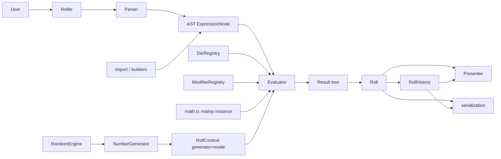

# rpg-dice-roller v6: architecture and API

v6 is a clean-break rewrite in TypeScript. The dice notation is unchanged from v5; the classes, names and
structure are new. This document describes the design. Parts marked **stub** throw `NotImplementedError`
until their logic is written.

## Pipeline



1. `Parser` (Peggy grammar) turns notation into a typed, JSON-safe **AST** (`ExpressionNode`).
2. `Evaluator` walks the AST with a `RollContext` and builds a typed, JSON-safe **result tree**
   (`ExpressionResult`).
3. `Roll` wraps one result tree with its totals; `RollHistory` is a log of rolls.
4. A `Presenter` turns a roll, a history or a result node into any output (text, HTML, Markdown…).

`RollSettings` holds how notation is rolled (engine/generator, registries, limits, parser, evaluator).
`Roller` owns a `RollSettings`, a presenter and the history.

## Rolling: standalone or with a history

```ts
// a single roll, like v5's `new DiceRoll("4d6")`: rolls straight away
const stats = new Roll("4d6kh3");
stats.total; // e.g. 14
`${stats}`; // e.g. "4d6kh3: [3d, 5, 6, 3] = 14"
const again = stats.reroll(); // a new Roll, same notation and settings
new Roll("4d6", { engine: engines.MersenneTwister19937.seed(42) });
roll("4d6"); // the `roll()` function: shorthand for `new Roll("4d6")`

// rolls with a history
const roller = new Roller();
roller.roll("4d6"); // always added to the history
roller.history.total;
```

- `new Roll(input, options?)` takes notation or an AST, and `RollOptions` (`engine`, `dice`, `modifiers`,
  `limits`) or a `RollSettings`. Without options, rolls share private default settings (created on first
  use, so nothing global can be changed).
- `RollSettings` are used as they are, so they can be created once and shared by many rolls. A `Roller`
  passes its `roller.settings` to `new Roll()`, so standalone and roller rolls use the same code.
- `RollerOptions` are `RollOptions` plus `presenter`; presenting is the roller's job, not the roll's.
- A `Roll` is immutable, so `reroll()` returns a new roll instead of changing it (as v5's
  `DiceRoll.roll()` did); history entries never change.
- `Roll.fromJSON(data, options?)` / `Roll.import(data, options?)` restore an exported roll without
  rolling; `roller.import()` does the same for rolls or a history, and adds them to the history.

## v5 → v6 names

| v5                                              | v6                                                                                                                               |
| ----------------------------------------------- | -------------------------------------------------------------------------------------------------------------------------------- |
| `DiceRoller`                                    | `Roller` (config + services, `export` / `import`) and `RollHistory` (the log)                                                    |
| `DiceRoll`                                      | `Roll` (one evaluated notation; `new Roll(notation)` rolls straight away, `reroll()` returns a new roll)                         |
| `StandardDice` / `PercentileDice` / `FudgeDice` | `DieLike` values; presets `standardDie(n)`, `percentileDie`, `fudgeDie(1 \| 2)`, plus `rangeDie(min, max)`, `faceDie(faces)`     |
| Dice qty, modifiers and description             | `PoolNode` (AST)                                                                                                                 |
| `RollGroup`                                     | `GroupNode` (AST)                                                                                                                |
| `RollResult` / `RollResults` / `ResultGroup`    | `DieResult` / `PoolResult` / `GroupResult` (plus `NumberResult`, `BinaryResult`, `UnaryResult`, `ParenResult`, `FunctionResult`) |
| `Modifier` classes                              | `ModifierNode` (data) and `ModifierHandler` (behaviour)                                                                          |
| `ComparePoint` class                            | `ComparePoint` data and `matchesComparePoint()`                                                                                  |
| Global `generator` / `engines`                  | `RandomEngine`, a per-roller `NumberGenerator`, and `RollContext`                                                                |
| `toString()` / `output` / `modifier-flags.js`   | `Presenter.present()`, `TextPresenter` flag symbols; `toString()` is the default `TextPresenter`                                 |
| `exportFormats`                                 | `ExportFormat = "object" \| "json" \| "base64"`                                                                                  |
| `mathjs.evaluate()` on a joined string          | `Evaluator` calling mathjs functions through `evaluator/math.ts`                                                                 |

## Source layout

```
src/
  index.ts                 public exports + roll()
  Roller.ts Roll.ts RollHistory.ts RollSettings.ts
  ast/          nodes.ts (AST types), factory.ts (used by the grammar), builders.ts (stub), notation.ts (AST -> notation)
  dice/         types.ts, die-utils.ts (partly stub), presets.ts, DieRegistry.ts
  modifiers/    types.ts, compare-point.ts (stub), ModifierRegistry.ts, handlers/* (stubs)
  evaluator/    Evaluator.ts (stub, dispatch implemented), RollContext.ts, math.ts
  results/      types.ts, flags.ts, die-result.ts (stub)
  random/       RandomEngine.ts, NumberGenerator.ts, engines.ts
  presenters/   Presenter.ts, Presentable.ts, TreePresenter.ts, TextPresenter.ts (stub hooks)
  parser/       Parser.ts, grammar.pegjs, generated/ (build output, git-ignored)
  serialization/ formats.ts, encode.ts (stub), decode.ts (stub)
  errors/       DiceRollerError and subclasses
```

Public exports: the main classes (`Roller`, `Roll`, `RollHistory`, `RollSettings`), `roll()`, the
common types (including `RollContext`, `NumberGenerator` and `RandomEngine` as types, for custom dice,
engines and modifier handlers), and the namespaces `ast`, `dice`, `engines`, `errors`, `modifiers`,
`presenters` and `results`.

Everything else is internal and can change without a major version: `Parser`, `Evaluator`,
`createRollContext`, the `math.ts` lookup tables, `encode` / `decode` (use `export()` / `import()`),
the die helpers in `dice/die-utils.ts` (`resolveDie`, `rollDie`, `dieMin`, `dieMax`, `dieAverage`,
`faceCount`, `dieNotation`; handlers get a `ResolvedDie` and `rollDie()`, presenters get a
`DieSnapshot`), the grammar constants, small type guards and `NotImplementedError`.

## Contracts

### AST (`ast/nodes.ts`)

```ts
type ExpressionNode =
  | NumberNode
  | PoolNode
  | GroupNode
  | BinaryNode
  | UnaryNode
  | ParenNode
  | FunctionNode;

interface PoolNode {
  type: "pool";
  qty: ExpressionNode; // NumberNode for literals, ParenNode for `(2+3)d6`
  die: DieNode;
  modifiers: ModifierNode[];
  description?: DescriptionNode; // { text, style: "inline" | "block" }
}

// a reference to a die factory in the DieRegistry, with expression arguments
interface DieNode {
  type: "die";
  name: string; // "standard" | "percentile" | "fudge" | "range" | "face", or a user-registered name
  args: ExpressionNode[];
}
// d6      -> { type: "die", name: "standard", args: [6] }
// d(2+3)  -> { type: "die", name: "standard", args: [(2+3)] }
// d%      -> { type: "die", name: "percentile", args: [] }
// dF.1    -> { type: "die", name: "fudge", args: [1] }
```

- Every node is readonly plain data with a `type`; the parser, the builders and `import()` all use this
  shape, so `JSON.parse(JSON.stringify(node))` equals `node`.
- Qty and die arguments are child nodes, not numbers, so inline rolls (`(d6)d10`, `d(d6)`) only need a
  grammar change later.
- The AST never contains die objects: the evaluator evaluates `die.args` and calls
  `registry.create(die.name, ...args)`. So the AST stays JSON-safe even for dice with methods, and a
  roller that registers its own `standard` changes what `d6` rolls.
- Modifiers are discriminated by `name` (11 variants). They keep their notation order; a repeated modifier
  replaces the earlier one (last wins, first position kept), as in v5.
- `nodeToNotation()` writes canonical notation (`1d6` → `d6`, `k3` → `kh3`) and keeps `d%`, `dF`,
  `dF.1` and `dF.2`. Dice without notation (`range`, `face`, user-registered) are written as
  `dname(args)`, e.g. `drange(-2, 3)`, which is display-only.

### Dice (`dice/types.ts`)

```ts
type NumberOrGetter = number | (() => number); // functions are called with the die as `this`
type DieDefinition =
  | { min: NumberOrGetter; max: NumberOrGetter; notation?: string }
  | { faces: readonly number[]; notation?: string };
interface DieBehaviour {
  min: NumberOrGetter;
  max: NumberOrGetter;
  average: NumberOrGetter;
  faceCount: NumberOrGetter;
  roll(generator: NumberGenerator): number;
}
type DieLike = DieDefinition & Partial<DieBehaviour>;
type DieFactory = (...args: number[]) => DieLike; // registered by name in the DieRegistry
```

- No base class: a die is a plain object, a class instance or an object with methods. Whatever a die
  doesn't provide falls back to the helpers in `die-utils.ts`.
- `notation` is the display label after the `d` (`6`, `%`, `F`, `F.1`), used by presenters through
  `DieSnapshot.notation`.
- Dice have no `id`: the factory name in the `DieNode` identifies them.

#### Presets (`dice/presets.ts`)

| Preset                              | Die                                           | `notation`  | Registry factory                |
| ----------------------------------- | --------------------------------------------- | ----------- | ------------------------------- |
| `rangeDie(min, max, { notation? })` | every integer from `min` to `max`             | (none)      | `range(min, max)`               |
| `faceDie(faces, { notation? })`     | the listed faces (repeats weight)             | (none)      | `face(...faces)`                |
| `standardDie(n)`                    | `rangeDie(1, n)`                              | `n`         | `standard(n)` (`dn`)            |
| `percentileDie`                     | `rangeDie(1, 100)`                            | `%`         | `percentile()` (`d%`)           |
| `fudgeDie(2)` / `fudgeDie(1)`       | `faceDie([-1, 0, 1])` / `[-1, 0, 0, 0, 0, 1]` | `F` / `F.1` | `fudge()` / `fudge(1)` (`dF.1`) |

- Every preset returns a frozen die. `faceDie()` copies and freezes the faces.
- `rangeDie()` needs integers with `min <= max` (negatives allowed); `faceDie()` needs at least one face,
  all finite numbers. Both throw `ValidationError` otherwise.
- Without a `notation`, the label is display-only (see `dieNotation()`) and doesn't parse back.

#### Registry (`dice/DieRegistry.ts`)

Die factories by name: `register(name, factory)`, `get(name)` (`undefined` if missing), `getOrThrow(name)`, `has(name)`, `remove(name)`,
`create(name, ...args)` and `names`. `new DieRegistry()` comes with `standard`, `percentile`, `fudge`,
`range` and `face`; `DieRegistry.empty()` has none. `ModifierRegistry` works the same way
(`new ModifierRegistry()` has the 11 built-in handlers, `ModifierRegistry.empty()` none, plus
`getOrThrow(name)` and `remove(name)`).

```ts
const registry = new DieRegistry();
registry.remove("face"); // true; `false` if nothing was registered with the name
registry.get("standard")?.(6); // a d6
registry.create("standard", 6); // the same, but throws ValidationError for an unknown name
registry.register("fib", () => dice.faceDie([1, 1, 2, 3, 5, 8]));
registry.register("loaded", (sides) => new LoadedDie(sides)); // classes are wrapped in a function
registry.register("standard", (sides) => myDie(sides)); // replaces what `d6` rolls
```

Factories are plain functions rather than classes, so the registry never has to guess whether to
call `new`.

#### Helpers (`dice/die-utils.ts`, internal)

- `resolveDie()` normalises any `DieLike` into a `ResolvedDie` (plain numbers and a `roll()`).
- `rollDie()` returns `max` / `min` in `max` / `min` mode (ignoring a custom `roll()`); otherwise it uses
  the die's `roll()`, or `generator.integer(min, max)` / `faces[generator.integer(0, n - 1)]`.

### Results (`results/types.ts`)

Every result has a `type`, the `node` it came from and its `value`. Dice and group members are
`ScoredItem`s: `value`, `calculationValue` (e.g. `1` / `-1` / `0` for targets), `useInTotal` (false when
dropped) and semantic `flags` (`"explode"`, `"drop"`…). Symbols such as `!` or `d` only exist in
`TextPresenter`.

### Modifiers (`modifiers/types.ts`)

```ts
interface ModifierHandler<N extends ModifierNode = ModifierNode> {
  readonly name: N["name"];
  readonly order: number; // min 1, max 2, explode 3, re-roll 4, unique 5, keep 6, drop 7, target 8, cs 9, cf 10, sort 11
  readonly appliesTo: readonly ("pool" | "group")[]; // keep, drop, target and sort also apply to groups
  apply<T extends ScoredItem>(
    items: readonly T[],
    input: ModifierInput<N>,
  ): T[]; // never mutates
}
```

Handlers run in `order`, whatever the order in the notation. A single-expression group (`{4d6+2d8}k2`)
applies its modifiers to the dice of every pool inside it, as in v5.

### Rolling (`evaluator/`)

```ts
interface RollContext {
  generator: NumberGenerator;
  mode: "random" | "min" | "max";
  limits: { maxQty: number; maxIterations: number }; // defaults 999 / 1000
}
```

- No global mutable state: each `RollSettings` (so each `Roller`) has its own `NumberGenerator`, and the
  mode is part of the context.
  `minTotal` / `maxTotal` evaluate the same AST in `min` / `max` mode.
- `Roll.total` is calculated straight away (rounded to 2 decimal places); `minTotal` / `maxTotal` are
  lazy and cached, and `averageTotal` is their midpoint (v5 semantics, not the statistical mean). Imported
  rolls use their stored totals.

### Presenters (`presenters/`)

```ts
type Presentable = Roll | RollHistory | ExpressionResult;
interface Presenter<T = string> {
  present(target: Presentable): T;
}
```

- `TreePresenter<T>` implements `present()` and dispatches to protected hooks: `history()`, `roll()`,
  and one per result type (`number()`, `pool()`, `die()`, `group()`, `binary()`, `unary()`, `paren()`,
  `fn()`).
- `TextPresenter` matches v5 text output (`4d6: [3, 5, 2, 6] = 16`), with configurable `flagSymbols`
  and `separator` (`"; "`). **Hooks are stubs.**
- `Roll`, `RollHistory` and `Roller` keep `toString()`, which always returns the shared
  `defaultTextPresenter` output, so `` `${roll}` `` works whatever presenter the roller uses.
  `Roller<T>` takes a `Presenter<T>`, and `roller.present()` returns `T`.

### Export / import (`serialization/`)

```ts
interface RollData {
  type: "roll";
  version: 1;
  notation: string;
  result: ExpressionResult;
  total: number;
  minTotal: number;
  maxTotal: number;
  averageTotal: number;
}
interface HistoryData {
  type: "history";
  version: 1;
  rolls: RollData[];
  total: number;
}
```

`roll.export(format)` and `roller.export(format)` return the data (`"object"`) or a JSON / base64 string
(default `"json"`). `roller.import(data)` accepts any of these and appends the rolls to the history;
`Roll.import(data, options?)` imports a single roll. Nothing needs restoring: pools refer to their die
by factory name (`DieNode`), the stored results already hold the dice values (`DieSnapshot`), and
`reroll()` creates the die again from the settings' `DieRegistry`. **Encode / decode are stubs.**

## Maths and precedence

- Maths uses a private mathjs instance in `evaluator/math.ts`, built with `create()` from only the 20
  functions used, and `{ predictable: true }`. The mathjs string parser isn't bundled, and the global
  mathjs config is never changed.
- Results match v5: floored modulo (`5 % -3 = -1`, `-5 % 3 = 1`, `x % 0 = x`), `round()` half away from zero
  (`round(-2.5) = -3`), `floor()` / `ceil()` snapping near-integers (`ceil((0.1+0.2)*10) = 3`), natural `log`.
- `predictable: true` returns `NaN` instead of complex numbers; v6 throws `EvaluationError` for `sqrt(-4)`,
  `log(-1)` and `0/0`. `(-8)^(1/3)` is the real cube root `-2`, and `1/0` is `Infinity`.
- Precedence comes from the grammar, copying mathjs: `^` / `**` (right-associative) bind tighter than
  unary minus (`-2^2 = -4`, `2^-1 = 0.5`), then `* / %` (left-associative), then `+ -`.
- As in v5, a minus sign must be directly followed by a number (`-4d6` and `-(2)` are invalid), and
  parenthesised qty / sides may only contain numbers and operators, with at least one operator.
- Bundles: the ESM build leaves mathjs and random-js external; the UMD build bundles them (about 71 KB
  gzip in total, compared with 191 KB gzip for the full mathjs alone in v5).

## Extension guides

### A custom die

```ts
class LoadedDie {
  readonly min = 1;
  constructor(readonly max = 6) {}
  roll(generator: NumberGenerator) {
    return generator.real(0, 1) < 0.5
      ? this.max
      : generator.integer(1, this.max - 1);
  }
}

roller.dice
  .register("fib", () => dice.faceDie([1, 1, 2, 3, 5, 8]))
  .register("zero-to-nine", () => dice.rangeDie(0, 9))
  .register("plain", () => ({ min: -2, max: 3 })) // a plain object works too
  .register("loaded", (sides) => new LoadedDie(sides));

// builders are stubs for now
roller.roll(ast.pool(4, ast.die("fib")));
roller.roll(ast.pool(2, ast.die("loaded", 20)));
roller.roll(ast.pool(3, ast.die("range", -2, 3))); // the built-in `range` factory
```

Every die is created through the registry, so a die must be registered before it's used. Until the
grammar gets custom-die notation, registered dice are used through the builders (or an AST).

### A custom engine

Any object with `next(): number` (a 32-bit integer), e.g. the random-js engines:

```ts
new Roller({ engine: engines.MersenneTwister19937.seed(42) });
new Roll("4d6", { engine: engines.MersenneTwister19937.seed(42) });
```

### A custom modifier

Add a `ModifierNode` variant and a grammar rule (for notation), then register a handler:

```ts
roller.modifiers.register({
  name: "keep",
  order: 6,
  appliesTo: ["pool", "group"],
  apply: myKeep,
});
```

Registering a handler with an existing name replaces the built-in one.

### A custom presenter

```ts
class HtmlPresenter extends presenters.TreePresenter<HTMLElement> {
  protected roll(roll: Roll) {
    /* wrap this.visit(roll.result) */
  }
  // … one hook per result type
}

const roller = new Roller({ presenter: new HtmlPresenter() });
roller.present(); // HTMLElement for the whole history
roller.roll("4d6").present(new HtmlPresenter()); // HTMLElement for one roll
```

## Toolchain

- TypeScript is pinned to 6.0.x: `ts-jest` (< 7) and `typescript-eslint` (< 6.1) don't support
  TypeScript 7 yet.
- `npm run build` generates the parser (Peggy 5, ES output + `.d.ts`), type-checks, lints, and builds the
  ESM / UMD bundles (Rollup 4) and `types/`.
- `npm test` runs Jest (`ts-jest`) on `tests/**/*.test.ts`; `tests/**/*.test-d.ts` are compile-time
  type tests checked by `npm run typecheck`.
- `npm run lint` runs ESLint (recommended + typescript-eslint type-checked + stylistic) and Prettier
  (default options); `npm run format` fixes formatting.
- The v5 tests are kept unchanged in `tests/v5/`, excluded from every run.

## Open follow-ups

- Implement the stubs: dice helpers, `matchesComparePoint`, the result helpers, the evaluator, the 11
  modifier handlers, the `TextPresenter` hooks, the builders, and encode / decode.
- Inline rolls in qty / sides (`(d6)d10`): the AST and evaluator already support them; only the grammar
  needs extending (`ComputedValue` currently only accepts numeric maths).
- Custom-face notation (e.g. `d{1,1,2,3,5,8}`): `[...]` is already the description syntax, so a face
  syntax must avoid it.
- Convert the v5 tests in `tests/v5/` to TypeScript: remove redundant cases, use `test.each` tables, split
  by behaviour, and add a Jest coverage threshold.
- Replace `random-js` (unmaintained): only `random/NumberGenerator.ts` and `random/engines.ts` import it.
